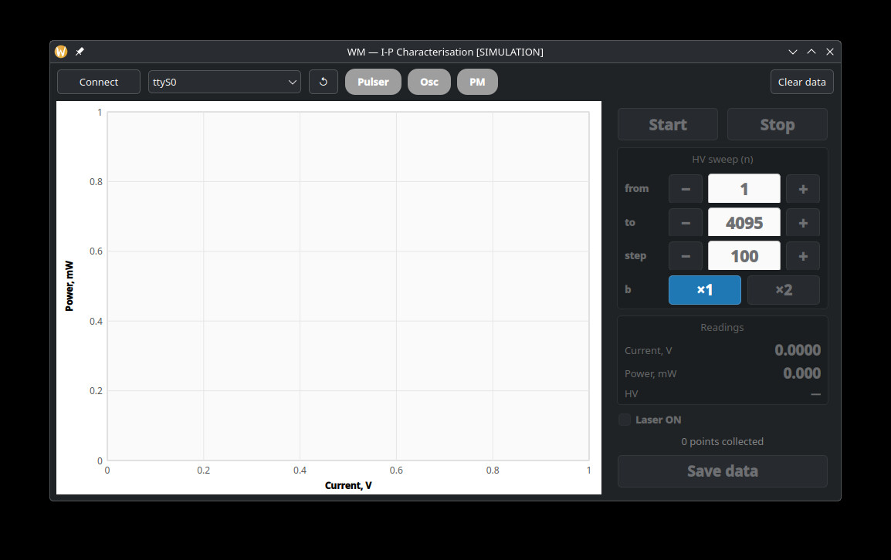

# IP_char — Laser Diode I-P Characterisation Tool

A Qt6 Widgets desktop application for measuring and plotting laser diode **current vs. optical power (I-P)** characteristics. It drives a pulsed laser over serial, reads laser current from a PicoScope 2000 USB oscilloscope, and measures optical power with a Thorlabs PM101A power meter — kiosk-styled for a touchscreen with no physical keyboard.

For a full usage walkthrough see [docs/user_guide.md](docs/user_guide.md). Hardware command references: [docs/commands_pulser.md](docs/commands_pulser.md), [docs/commands_pm100a.md](docs/commands_pm100a.md), [docs/commands_ps2000.md](docs/commands_ps2000.md).



---

## Hardware

| Device | Connection | Purpose |
|--------|-----------|---------|
| LaserPulser4_1 | USB-serial (9600 8N1, selectable port) | Sets HV current setpoint, controls laser on/off, sets pulse parameters |
| PicoScope 2000 | USB | Ch-A: laser current (triggered peak detection on negative pulse) |
| Thorlabs PM101A | USB, spoken over **libusb** (not the kernel `usbtmc` driver — it fails on and wedges the PM101A) | Optical power measurement via SCPI over USBTMC |

### Laser pulser protocol (ASCII, CR-terminated)

| Command | Description |
|---------|-------------|
| `HV:n,b` | Set high voltage DAC: `n` = 0–4095, `b` = multiplier (1=×1, 2=×2) |
| `P:w,p` | Pulse width `w` and period `p` in 50 ns steps |
| `MS:ws,ps` | Synchronous modulation: `ws` on-pulses per `ps` total |
| `ON` / `OFF` | Enable / disable laser driver |

**Default pulse settings on connect:** 150 ns width, 10 kHz effective rate (via `P:3,200` + `MS:1,10`).

### Oscilloscope wiring

- **Channel A** — current-sense output (negative pulse, ~150 ns); triggered on falling edge at −5000 ADU. Peak of the captured waveform, averaged over 100 blocks with auto-ranging, is used as the pulse amplitude.

### PM101A setup

- Auto-ranging enabled, units: Watts
- Wavelength correction: 1550 nm default; set via `Powermeter::setWavelength(nm)` before `start()`
- Hardware averaging: 100 samples (~300 ms per reading), 500 ms pause between queries
- The PM101A can power up in a wedged USBTMC state. `connect()` retries with a USBTMC `ABORT_BULK_IN` recovery; if that's not enough, `run.sh` power-cycles the meter's hub port via `uhubctl` before launch (see [Running on the Pi](#running-on-the-raspberry-pi) below)

---

## Software Dependencies

| Library | Notes |
|---------|-------|
| Qt 6 (≥ 6.2) | Widgets, SerialPort |
| libusb-1.0 | power meter USBTMC I/O |
| libps2000 | PicoScope 2000 driver — installs to `/opt/picoscope/` on a dev box, or a system path from the PicoTech apt repo on the Pi |
| uhubctl | hub-port power-cycling for the PM101A un-wedge fallback (Pi deployment only) |
| CMake ≥ 3.16, GCC/Clang C++17 | |

`./build.sh deps` installs all of the above (apt on Debian/Raspberry Pi OS, dnf on Fedora), adds the user to `dialout` for serial access, installs a udev rule + kernel-module blacklist so the PM101A is never grabbed by the kernel `usbtmc` driver, and grants passwordless `sudo` for `uhubctl` (needed so `run.sh` can run unattended on the kiosk). Run it once per machine:

```bash
./build.sh deps
```

`libps2000` itself is not packaged by `build.sh deps` on Fedora/x86 — install it from [picotech.com/downloads/linux](https://www.picotech.com/downloads/linux) into `/opt/picoscope/`. On the Pi it comes from the PicoTech apt repo (see below).

---

## Build

```bash
./build.sh          # clean build -> bin/WM
./build.sh run      # clean build, then run
./build.sh sim      # clean build, then run in simulation mode (-sim)
```

Or manually:

```bash
mkdir build && cd build
cmake ../src -DCMAKE_BUILD_TYPE=Release
cmake --build . -j$(nproc)
```

The binary is written to `bin/WM`.

### Building on the Raspberry Pi

Target board: **Raspberry Pi Zero 2 W** with a 7" 1024×600 HDMI touchscreen, running stock Raspberry Pi OS (Qt 6.4 — no from-source Qt build needed).

```bash
curl -L "https://labs.picotech.com/debian/picotech.list" | sudo tee /etc/apt/sources.list.d/picotech.list
sudo apt update && sudo apt install libps2000
./build.sh deps
./build.sh
```

The Zero 2 W has a single micro-USB data port, but four USB devices (PicoScope, power meter, pulser, touchscreen) — a **powered USB hub** (4+ ports) is required, plus a solid, separate 5 V supply for the Pi itself (a weak supply causes brown-out disconnects that look like hardware faults).

### Running on the Raspberry Pi

```bash
./run.sh          # power-cycles the PM101A's hub port (if wedged), then launches ./bin/WM
./run.sh -sim     # same, but simulation mode
```

Use `run.sh` rather than `./bin/WM` directly on the kiosk — it's the un-wedge fallback for the PM101A described above.

---

## Running

```bash
./bin/WM          # normal mode (requires hardware)
./bin/WM -sim     # simulation mode — synthesises a laser L-I curve, no hardware needed
```

In **simulation mode** the title bar shows `[SIMULATION]`, **Connect** marks all three devices connected instantly, and a sweep generates a realistic threshold-plus-slope L-I curve (sped up to ~250 ms/point) so the UI, plotting and CSV export can be exercised without any instruments attached.

Connect the pulser, oscilloscope and power meter with a single **Connect** click (top bar) after selecting the pulser's serial port (use **↺** to refresh the list if it was just plugged in). The status pills (Pulser / Osc / PM) turn green as each device comes up; **Start** enables once all three are connected.

See [docs/user_guide.md](docs/user_guide.md) for the full measurement walkthrough, sweep math, and troubleshooting table.

---

## Touchscreen input

The kiosk has no physical keyboard, so text/number entry fields open an on-screen control instead of relying on `QFileDialog`/typed input:

- **Save data** filename → tap it to open a full on-screen QWERTY keyboard ([virtualkeyboard.h/cpp](src/virtualkeyboard.cpp), hosted in [savefiledialog.h/cpp](src/savefiledialog.cpp)).
- **HV sweep from / to / step** → tap the value to open a numeric keypad for typing an exact number instead of tapping +/- repeatedly ([virtualnumberpad.h/cpp](src/virtualnumberpad.cpp), hosted in [numberinputdialog.h/cpp](src/numberinputdialog.cpp), wired into [stepper.h/cpp](src/stepper.cpp)).

Both are built in-app with no extra Qt module dependency, to stay on the stock Qt 6.4 the Pi ships.

---

## Saving data

Click **Save data**, type a filename on the on-screen keyboard, and confirm. Data is written as CSV into the app's working directory:

```
# IP characterisation — 2026-05-17T14:32:01
# HV n_from=100 n_step=25 n_to=4095 b=1
# Points: 39
HV_n,Current_V,Power_mW
100,0.00443,1.234
...
```

---

## Project Structure

```
src/
  main.cpp                — Qt entry point, -sim flag handling
  wm.h / wm.cpp            — main window: UI, sweep control, device coordination
  oscilloscope.h/cpp       — Osc (QThread): triggered peak acquisition via PicoScope
  powermeter.h/cpp         — Powermeter (QThread): MEAS:POW? loop via PM101A over libusb/USBTMC
  pulser.h/cpp             — Pulser (QObject, own thread): serial control of laser driver
  plotwidget.h/cpp         — lightweight I-P plot (no QCustomPlot/QtGraphs dependency)
  stepper.h/cpp            — touch stepper (-/+ and tap-to-type) for HV sweep values
  virtualkeyboard.h/cpp    — on-screen QWERTY keyboard
  virtualnumberpad.h/cpp   — on-screen numeric keypad
  savefiledialog.h/cpp     — touch-friendly replacement for QFileDialog::getSaveFileName
  numberinputdialog.h/cpp  — touch-friendly replacement for QInputDialog::getInt
  CMakeLists.txt
bin/
  WM                       — compiled binary
build/                     — CMake build artifacts
docs/                      — user guide, hardware command references, debug notes, screenshot
tests/                     — standalone Python scripts to test each instrument independently (see tests/README.md)
```

### Threading model

| Component | Thread | Communication |
|-----------|--------|---------------|
| `WM` (UI) | Main thread | Qt signals/slots |
| `Osc` | `osc` thread | emits `sendData(current_V)` → `WM::read_values()` |
| `Powermeter` | `pm` thread | emits `sendPower(W)` → `WM::read_power()` |
| `Pulser` | `pulserThread` | receives queued signals from WM; never blocks the UI |
